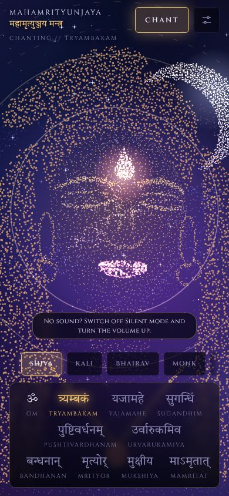
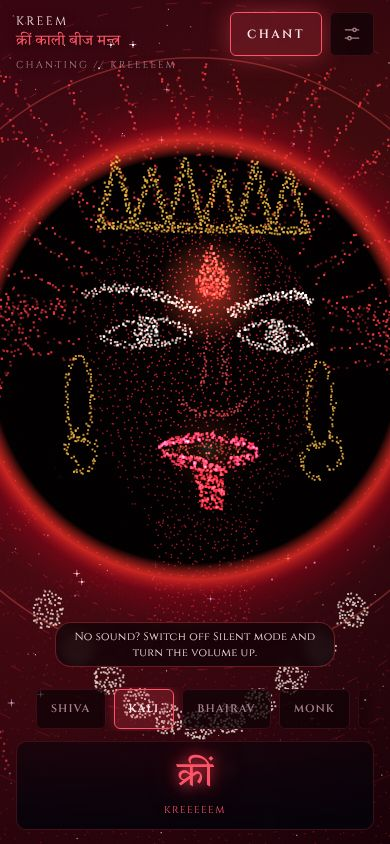
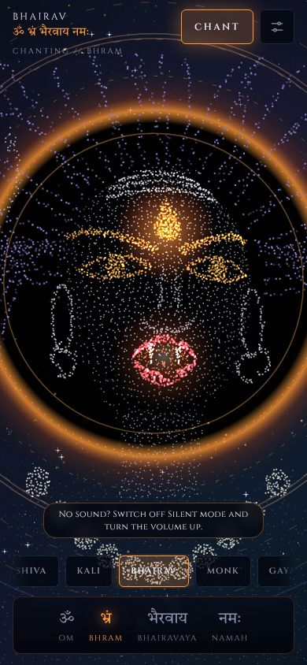
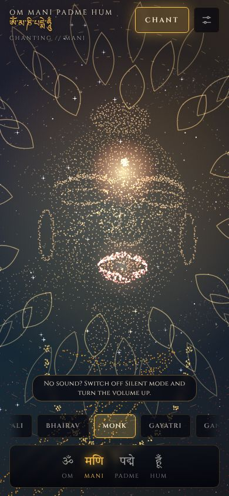
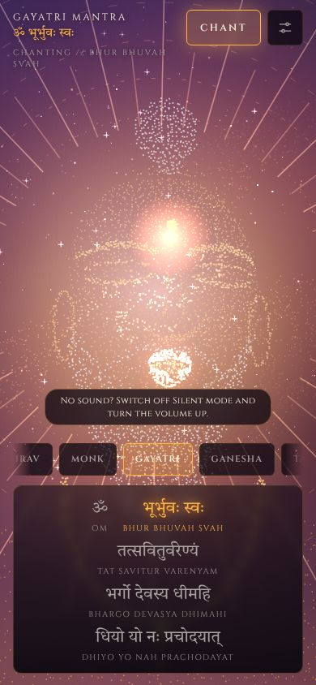
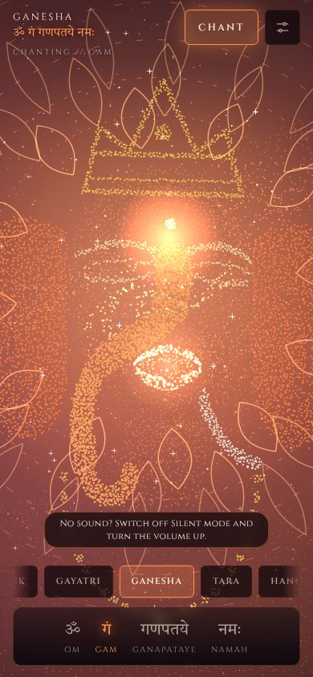
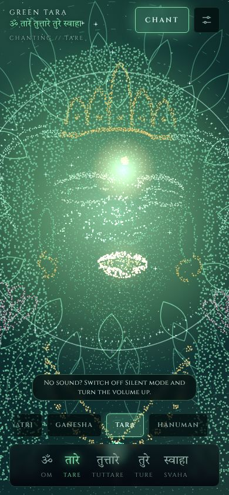
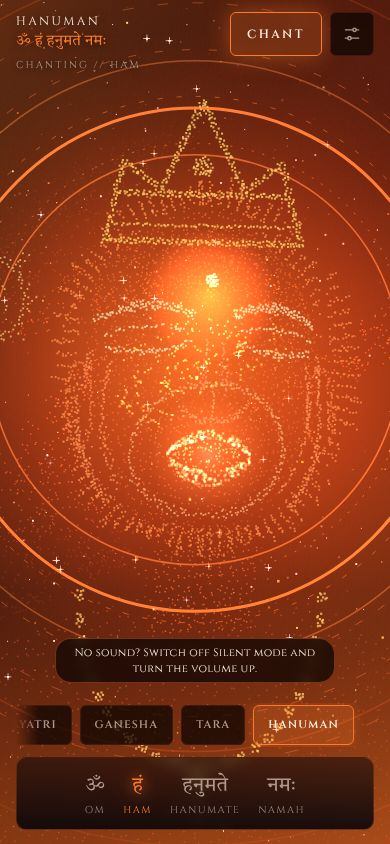

# Mantra Cosmosis

Eight devotional figures built entirely from particles, chanting their mantras in deep space. Each one has its own sky, its own sound, and lips that move syllable by syllable with the chant.

Everything runs in the browser from one file (`index.html`). No build step, no framework, no recordings: the figures are drawn from shapes sampled into particles on a canvas, and the voices, drones and bells are synthesised live with the Web Audio API.

| | |
|---|---|
|  |  |
|  |  |
|  |  |
|  |  |

## The figures and their mantras

| Figure | Mantra | Sky |
|---|---|---|
| Shiva | Mahamrityunjaya, or Om Namah Shivaya | indigo night, golden halo, crescent moon |
| Kali | Kreem (a long wailing seed sound) | crimson and black, red eclipse |
| Bhairav | Om Bhram Bhairavaya Namah | near-black sky, orange fire ring, rising embers |
| Monk | Om Mani Padme Hum | teal night, golden lotus, optional Tibetan overtone voice |
| Gayatri sage | Gayatri Mantra | rising sun with turning rays |
| Ganesha | Om Gam Ganapataye Namah | rose and saffron, lotus of petals |
| Green Tara | Om Tare Tuttare Ture Soha | emerald light, pearl halo, lotus |
| Hanuman | Om Ham Hanumate Namah | dusk fire, ring of flame |

Each mantra shows its words one by one as they are chanted, with a short **Meaning** line and a short **Gyan** note in Hindi and English.

## Using it

1. Open `index.html` in any modern browser (or serve the folder with any static host).
2. Swipe the strip near the bottom to choose a figure.
3. Tap **Chant**. Sound starts only after a tap, as browsers require.

Settings (the sliders icon, top right):

- **Gather**: the figure blows apart and spirals back together as the chant begins. On by default; turn it off to start chanting immediately.
- **Choir**: stacks extra voices (a fifth above, an octave below, two detuned copies).
- **Overtone** (Monk only): a deep voice with a whistled harmonic over it.
- **Mantra** (Shiva only): switch between Mahamrityunjaya and Om Namah Shivaya.
- **Voice** (Shiva only, if your device has a Hindi voice): switch between the synthesised chant and the device's spoken Hindi voice. The synthesised chant is the default.
- **Drone**, **Meaning**, **Gyan**, **My recording** (play any audio file and let the lips follow its loudness).

## How it works

- **Figures**: shapes are drawn to hidden canvases, then sampled into thousands of particles with depth, so the head can turn toward the pointer. Mouth parts (lips, inner mouth, tongue, fangs) are separate particle groups re-aimed every frame from the chant timing.
- **Voice**: detuned sawtooth waves through three vowel filters (formants) that glide per syllable, with vibrato, a sub-bass layer and a generated temple reverb. Each mode has its own pitch and character. Bells, drums, a rising whoosh and a boom are all generated too.
- **Cosmos**: pre-rendered nebula textures, parallax stars, a rotating spiral galaxy, and per-figure atmosphere (halo, eclipse, sun, lotus, fire).
- **Performance**: caches colours and gradients, pauses when the tab is hidden, respects reduced-motion, and an automatic governor draws fewer particles on slow devices. Add `?q=0`, `?q=1` or `?q=2` to the URL to force a quality level.

## Known limits

- The voices are synthesised imitations, not recordings of people. They are meant to evoke, not to teach pronunciation.
- On iPhone, web audio is muted by the silent switch; the page works around it, but check Silent mode if you hear nothing.
- Once the quality governor lowers quality on a slow device, it stays lowered until reload.
- Hiding the tab pauses the animation but not the chant sound.
- The page loads fonts from Google Fonts; everything else is in the file.

## Content notes

This piece depicts deities and holy mantras of Hindu and Buddhist traditions. It is made with reverence and is not affiliated with any organisation. Please see [CONTENT_REVIEW.md](CONTENT_REVIEW.md) for the text that should be checked by a native Hindi or Sanskrit speaker before wider release.

## Ideas for later

More figures (Lakshmi, Durga, Krishna, Saraswati, Nam Myoho Renge Kyo), recorded or sampled chant layers, shareable links to a figure, and a gentle timer mode for meditation.

## Licence

Not yet chosen. Add a `LICENSE` file before publishing publicly.
